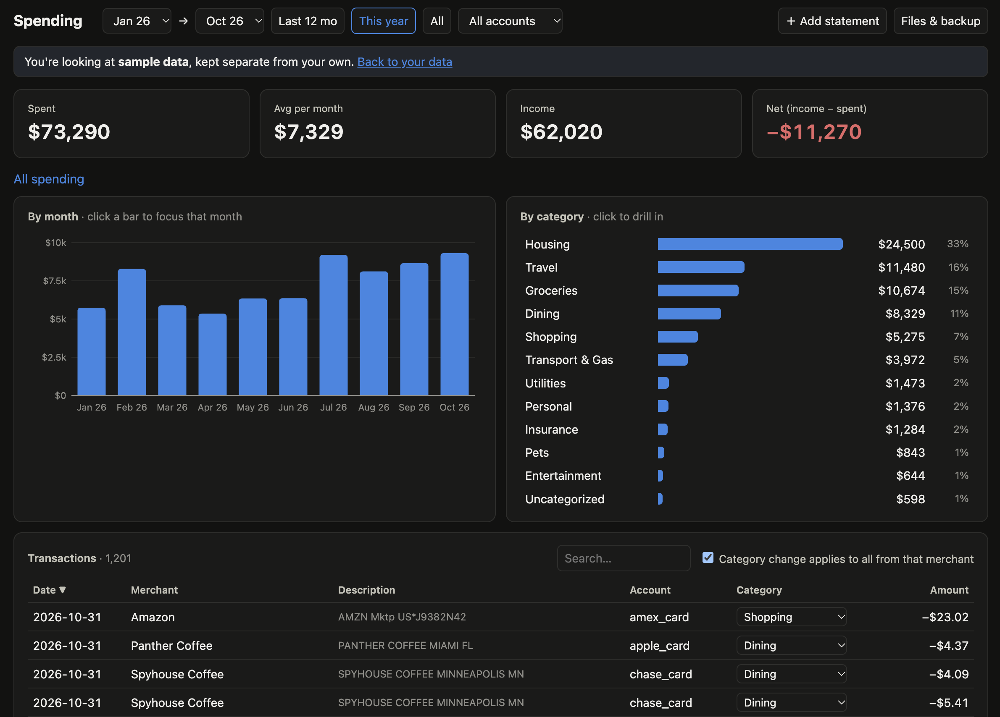

# Spending: see where your money goes

A spending dashboard that runs entirely in your web browser. There's nothing to install and no
account to create, and your bank statements are never uploaded: everything stays on your computer.

**Open it: https://spending-app.github.io/spending/**



## Use it
1. Open **https://spending-app.github.io/spending/**.
2. On your bank's or card's website, download your account activity as a **CSV** file.
3. Drop the files onto the page (or click **Add statement**). Add as many accounts as you like.

Not ready to use your own data? Click **Try it with sample data**.

- Click a category to see its merchants, then a merchant to see its transactions. Click a month bar to focus that month.
- Wrong category? Change it in the table. With "applies to all from that merchant" checked, it also
  remembers that choice for that merchant's future statements. In a category's merchant list, each
  merchant has its own category picker.
- Hover over a category to see what belongs in it.

## Your data
- Statements and your category choices are saved **in this browser only**. They don't sync to other
  computers or browsers.
- Clearing your browser's site data erases them, so use **Files & backup → Download backup** now and
  then. **Restore backup** brings everything back, on any computer.
- CSV only. PDF statements aren't supported.

## Run it yourself
Any static file server works, since the app is just the files in `web/`:
```
python3 -m http.server -d web 8765    # then open http://127.0.0.1:8765
```
Pushing to `main` publishes `web/` to GitHub Pages (see `.github/workflows/pages.yml`).
